# Divide and Conquer Lab


Two classic divide-and-conquer problems, implemented in Java and analysed in depth.

| # | Problem | Idea | Complexity |
|---|---------|------|-----------|
| 1 | [Median selection](#problem-1--median-selection) | Randomized Select vs. Median of Medians vs. Sort, benchmarked up to 10 million elements | `O(n)` expected / `O(n)` worst case / `O(n log n)` |
| 2 | [Minimum perimeter triangle](#problem-2--minimum-perimeter-triangle) | Closest-pair style divide and conquer with a strip and a bounded search box | `O(n log n)` |

---

## Table of contents

- [Repository layout](#repository-layout)
- [Problem 1 — Median selection](#problem-1--median-selection)
    - [Algorithms](#algorithms)
    - [Handling duplicates](#handling-duplicates)
    - [Benchmark methodology](#benchmark-methodology)
    - [Results](#results)
    - [Findings](#findings)
    - [How to run](#how-to-run)
- [Problem 2 — Minimum perimeter triangle](#problem-2--minimum-perimeter-triangle)
    - [Input and output format](#input-and-output-format)
    - [Algorithm](#algorithm)
    - [Why the merge step is linear](#why-the-merge-step-is-linear)
    - [Complexity](#complexity)
    - [How to run](#how-to-run-1)
    - [Automated submission check](#automated-submission-check)

---

## Repository layout

```text
.
├── .github/                     # CI workflow that checks the submission
├── images/                      # figures used in this README
├── results/
├── problem1-median/
│   ├── src/
│   │   ├── main/java/com/cse321/median/
│   │   │   ├── SelectAlgorithm      # common interface: name(), select(a, k)
│   │   │   ├── RandomizedSelect
│   │   │   ├── MedianOfMedians
│   │   │   ├── SortSelect
│   │   │   ├── ArrayGenerator       # seeded random arrays
│   │   │   ├── BenchmarkRunner      # warm-up, timing, correctness check
│   │   │   ├── Stats                # result record (mean, median, ...)
│   │   │   ├── StatsCalculator      # computes the statistics
│   │   │   ├── BenchmarkReporter    # writes raw.csv / summary.csv
│   │   │   └── BenchmarkMain        # interactive entry point
│   │   ├── test/                    # unit tests
│   │   └── assembly/                # jar packaging descriptor
│   ├── results/                     # raw.csv, summary.csv, plots
│   ├── plot_benchmarks.py           # draws the plots
│   ├── problem1-median-submission.jar
│   └── pom.xml
└── problem2-triangle/
    ├── src/
    │   ├── main/java/com/cse321/triangle/
    │   │   ├── MinPerimeterTriangle # the solution
    │   │   └── Reader               # fast buffered input
    │   ├── test/java/com/cse321/triangle/
    │   │   └── MinPerimeterTriangleTest
    │   └── assembly/                # jar packaging descriptor
    ├── samples/                     # sample inputs / outputs
    └── pom.xml
```

---

# Problem 1 — Median selection

Given an unsorted array of `n` integers, find the **k-th smallest** element, where `k = ⌈n/2⌉` (the median).
Three algorithms implement the same `SelectAlgorithm` interface, so they can be benchmarked on identical inputs.

## Algorithms

### Randomized Select
Pick a random pivot, partition around it, and recurse into the one side that contains the k-th element.
A random pivot splits the array reasonably well on average, so the **expected time is `O(n)`**.
The worst case is `O(n²)`, but it happens with very small probability.

### Median of Medians (deterministic)
1. Split the array into groups of 5 and take the median of each group (constant time per group).
2. Recursively find the median of those `⌈n/5⌉` medians and use it as the pivot.
3. Partition around that pivot and recurse into the side that contains the k-th element.

This pivot guarantees that at least about `3n/10` elements are discarded at each step:

```text
T(n) ≤ T(n/5) + T(7n/10) + c·n
```

Since `1/5 + 7/10 = 9/10 < 1`, the recurrence solves to **`T(n) = O(n)` in the worst case**.

### Sort and index (baseline)
Sort the whole array and return `a[k-1]`. This takes `O(n log n)` and is also used as the reference answer for checking correctness.

| Algorithm | Time | Notes |
|-----------|------|-------|
| Randomized Select | `O(n)` expected, `O(n²)` worst | Simple, small constant factor |
| Median of Medians | `O(n)` worst case | Deterministic, larger constant factor |
| Sort + index | `O(n log n)` | Baseline and correctness oracle |

## Handling duplicates

Both partition routines send elements that are **equal to the pivot alternately to the left and to the right** side, using a toggle flag.
This spreads duplicates evenly, which prevents `O(n²)` behaviour and very deep recursion (stack overflow) on arrays with many equal values.

## Benchmark methodology

- **Sizes:** `10³, 5·10³, 10⁴, 5·10⁴, 10⁵, 5·10⁵, 10⁶, 2·10⁶, 5·10⁶, 10⁷`
- **Reproducible input:** arrays are generated with a fixed seed, and every algorithm runs on a copy of the same array.
- **Runs per size:** 100 for `n ≤ 10⁵`, 40 for `n ≤ 10⁶`, 20 for `n ≤ 5·10⁶`, 10 otherwise.
- **JVM warm-up:** 30 runs on arrays of size `10⁵`, plus 2 warm-up runs before every size, to reduce the effect of JIT compilation.
- **GC:** a garbage collection is forced and given time to settle before timing each algorithm.
- **Correctness:** every result is compared with the answer obtained by sorting. A wrong answer throws an exception and stops the benchmark.
- **Timing:** `System.nanoTime()`, reported in milliseconds. For each algorithm and size the mean, median, standard deviation, min and max are computed.

## Results

All times are in **milliseconds**. Standard deviation uses the sample formula (`N − 1`).
`RS` = Randomized Select, `MoM` = Median of Medians.

| n | RS mean | RS median | RS std | MoM mean | MoM median | MoM std | Sort mean | Sort median | Sort std |
|--:|--:|--:|--:|--:|--:|--:|--:|--:|--:|
| 1,000 | 0.043 | 0.043 | 0.009 | 0.108 | 0.101 | 0.018 | 0.052 | 0.068 | 0.035 |
| 5,000 | 0.196 | 0.200 | 0.042 | 0.371 | 0.314 | 0.146 | 0.235 | 0.184 | 0.169 |
| 10,000 | 0.132 | 0.100 | 0.105 | 0.360 | 0.335 | 0.093 | 0.454 | 0.392 | 0.229 |
| 50,000 | 0.479 | 0.441 | 0.228 | 1.618 | 1.572 | 0.130 | 2.391 | 2.322 | 0.330 |
| 100,000 | 1.149 | 1.029 | 0.449 | 3.347 | 3.059 | 1.367 | 5.091 | 4.982 | 0.494 |
| 500,000 | 4.386 | 4.271 | 0.978 | 16.240 | 15.942 | 1.453 | 28.335 | 27.970 | 1.430 |
| 1,000,000 | 8.533 | 8.698 | 1.518 | 32.453 | 32.209 | 0.949 | 60.132 | 59.598 | 1.719 |
| 2,000,000 | 16.946 | 17.184 | 2.989 | 63.621 | 63.151 | 1.433 | 134.982 | 131.018 | 8.671 |
| 5,000,000 | 47.172 | 46.460 | 6.364 | 178.853 | 170.516 | 22.583 | 427.810 | 408.541 | 49.457 |
| 10,000,000 | 109.297 | 112.410 | 18.907 | 356.581 | 351.613 | 36.769 | 899.249 | 881.539 | 68.103 |

The full data (including min and max) is in `problem1-median/results/summary.csv`; every single run is in `raw.csv`.

### Plots

Mean and median running time (linear axes, bands show ±1 standard deviation):

<p align="center">
  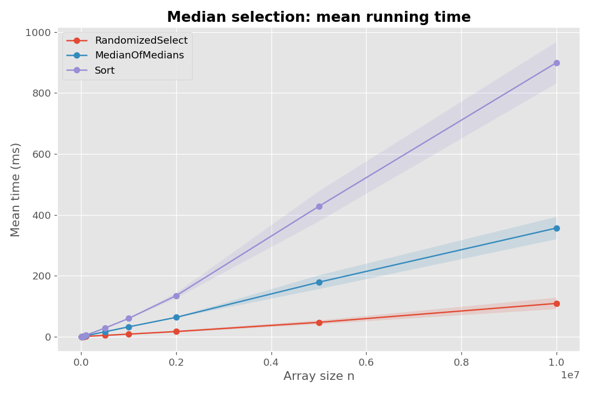
  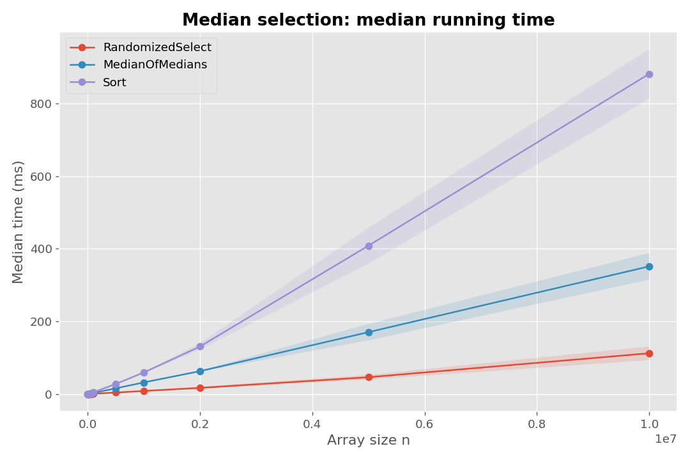
</p>

Mean and median time relative to Sort (a value below 1 means faster than Sort):

<p align="center">
  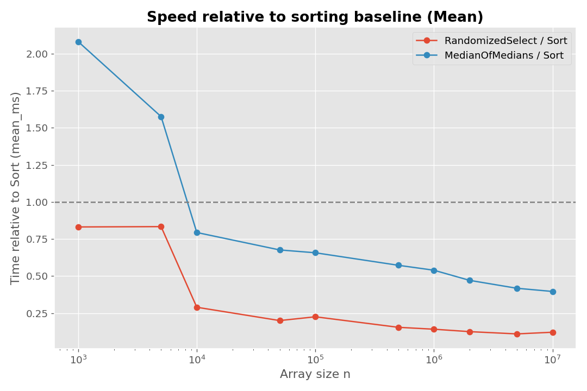
  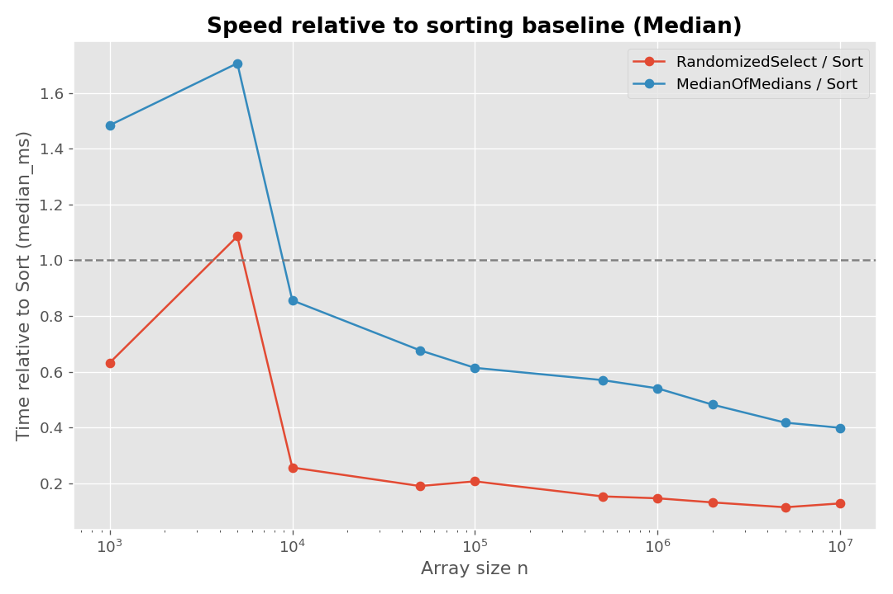
</p>

Standard deviation:

<p align="center">
  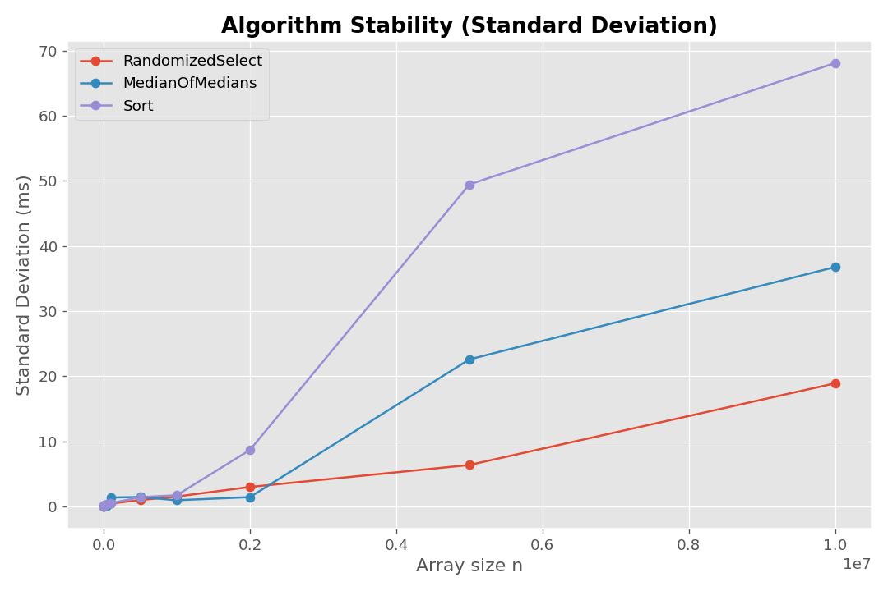
</p>

## Findings

- **Speed.** For tiny arrays (`n ≤ 5·10³`) Median of Medians is slower than Sort, and Randomized Select is only slightly faster. From `n = 10⁴` both selection algorithms beat Sort, and the gap keeps growing. At `n = 10⁷`, Randomized Select (109 ms) is about **8×** faster than Sort (899 ms) and Median of Medians (357 ms) is about **2.5×** faster.
- **Scaling.** For `n ≥ 5·10⁴` the time per element stays almost constant for Randomized Select (about 8.5–11.5 ns) and Median of Medians (about 32–36 ns), so both scale linearly. For Sort it grows from about 48 ns to 90 ns per element, as expected for `O(n log n)`.
- **Constant factor.** Median of Medians is roughly **3–4× slower** than Randomized Select. It has to sort groups of five, make an extra recursive call on the medians, and search for the pivot, while Randomized Select only draws one random number.
- **Stability.** In absolute terms Randomized Select has the smallest standard deviation, but relative to its mean it is the least stable (at `n = 10⁶`: 17.8% against 2.9% for both of the others). A random pivot gives a different recursion every run, while the other two do the same work every time.
- **Outliers.** The first runs of a size are often slower, which looks like JIT warm-up (for example Median of Medians at `n = 10⁵` has a maximum of 14.5 ms against a median of 3.1 ms). A later spike at `n = 5·10⁶` is possibly garbage collection or system activity. Because of such outliers the **median is more reliable than the mean for small `n`**.

**Conclusion:** the measurements agree with the theory. Randomized Select is the fastest in practice, Median of Medians pays a larger constant factor for its worst-case guarantee, and Sort grows like `n log n`.

## How to run

Build with Maven, then start the interactive benchmark **from the repository root** (the output folder `problem1-median/results` is relative to the directory you run from):

```bash
mvn -f problem1-median/pom.xml clean package
java -jar problem1-median/problem1-median-submission.jar
```

The program asks for two optional values (press Enter to accept the default):

| Prompt | Default | Meaning |
|--------|---------|---------|
| Max Size | all sizes | Largest `n` to benchmark (handy for a quick run) |
| Runs | `-1` (auto) | Number of runs per size, or `-1` to use the table above |

Results are written to `problem1-median/results/`. To redraw the plots:

```bash
python problem1-median/plot_benchmarks.py
```

Each algorithm class also has its own `main` with a small demo, so it can be run on its own.

---

# Problem 2 — Minimum perimeter triangle

Given `n` **distinct** points with **integer** coordinates, find the minimum perimeter among all triangles whose three vertices are chosen from the points.
Checking every triple takes `O(n³)`, which is far too slow, so the solution uses a divide-and-conquer approach in the spirit of the closest-pair algorithm.

## Input and output format

- The input contains several test cases. Each starts with `n`, followed by `n` lines `x y`.
- The input ends when `n = -1`.
- For every test case the program prints the minimum perimeter with **three digits after the decimal point**.
- If a test case has fewer than 3 points, no triangle exists and the result is infinity.

Input is read with a custom buffered reader instead of `Scanner`, which noticeably reduces the running time on large inputs.

## Algorithm

1. **Pre-sort** the points once by `x` (array `X`) and once by `y` (array `Y`).
2. **Base cases:** with fewer than 3 points return `∞`; with exactly 3 points return the perimeter of that triangle.
3. **Divide:** split `X` at the median into a left half and a right half, and split `Y` into `Y_L` and `Y_R` with one linear scan, keeping the y-order (no re-sorting).
4. **Conquer:** solve both halves recursively and set `δ = min(δ_L, δ_R)`.
5. **Merge:** look for a triangle with perimeter smaller than `δ` that has points on both sides of the median line. Only points inside a narrow strip around the line are considered, and each point is compared with a constant number of neighbours.

## Why the merge step is linear

The goal is to show that the merge step takes `O(n)` time. The argument has four steps.

### Step 1 — Divide and the value of δ

After solving both halves we know the best perimeter on the left, `δ_L`, and on the right, `δ_R`, and we set `δ = min(δ_L, δ_R)`.
Any triangle that lies entirely inside one half has perimeter at least `δ`, so the only triangle that can still improve the answer is one that **crosses the median line** and has perimeter smaller than `δ`.

<p align="center">
  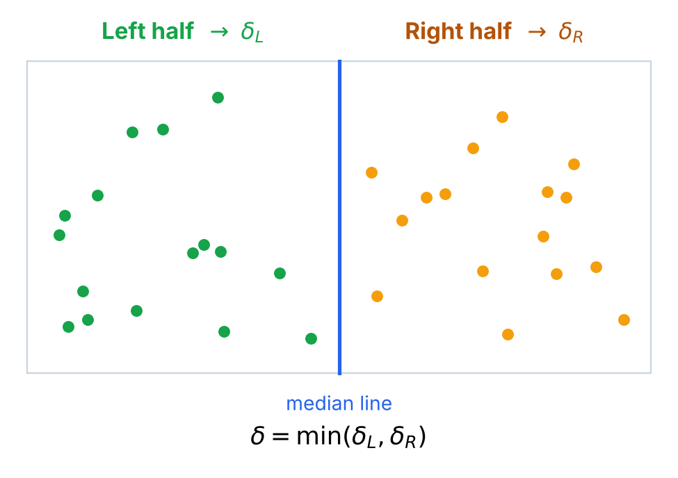
</p>

### Step 2 — The strip (width of the search area)

**Lemma 1.** Let `T` be a triangle with perimeter `P < δ` that has vertices on both sides of the median line. Then every vertex of `T` is within horizontal distance `δ/2` of the median line.

*Proof.* Each side of a triangle is shorter than the sum of the other two, so each side is shorter than half of the perimeter:

```text
side < P/2 < δ/2
```

Take any vertex `u` and a vertex `v` on the opposite side of the line. The line passes between them, so the horizontal distance from `u` to the line is at most the horizontal distance between `u` and `v`, which is at most `|uv| < δ/2`. Because `T` has points on both sides, every vertex has a vertex of `T` on the other side of the line, so the same holds for all three vertices. ∎

Therefore only the points whose x-coordinate is within `δ/2` of the median line need to be kept.

<p align="center">
  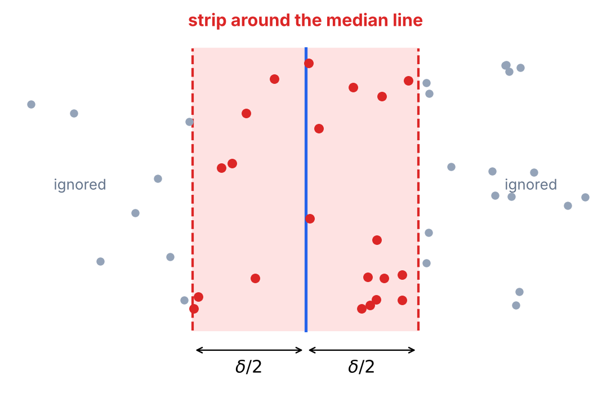
</p>

### Step 3 — The search box (height)

Scan the strip points in increasing order of `y`. For a triangle with perimeter smaller than `δ`, let `p_i` be its vertex that comes first in the y-order. The other two vertices are less than `δ/2` away in `y` (each side is shorter than `δ/2`), so they lie in the box

```text
[m − δ/2, m + δ/2] × [y_i, y_i + δ/2)        (m = x of the median line)
```

which is `δ` wide and `δ/2` tall. The question is: **how many points can this box contain?**

<p align="center">
  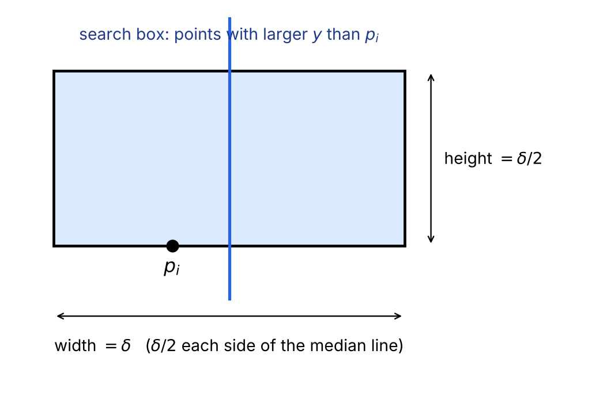
</p>

### Step 4 — At most 16 points in the box

Divide the box into **8 equal squares of side `δ/4`**: 4 squares in the left half and 4 in the right half. The median line is exactly the border between two columns of squares, so every left point lies in a left square and every right point lies in a right square.

<p align="center">
  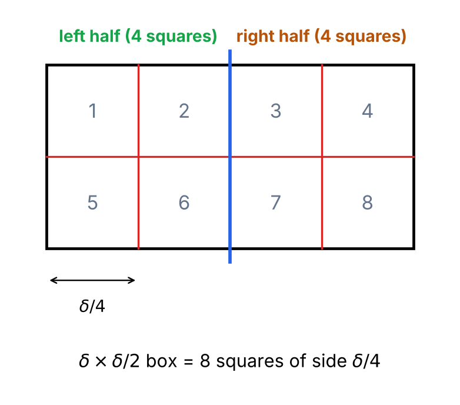
</p>

**Lemma 2.** Each `δ/4 × δ/4` square contains at most **2** points of its own half.

*Proof.* Suppose a square of side `s = δ/4` contained 3 points of the same half. The perimeter of a triangle is a convex function of its vertices, so its maximum over a square is reached at corners of the square. The largest such triangle is the right isosceles triangle with legs `s` and hypotenuse `√2·s`:

```text
P ≤ (2 + √2)·s ≈ 3.414 · δ/4 ≈ 0.854·δ < δ
```

That would be a triangle inside one half with perimeter smaller than `δ ≤ δ_L` (or `δ_R`), which contradicts the definition of `δ_L` (or `δ_R`) as the minimum of that half. If a half has fewer than 3 points the claim is trivial. ∎

<p align="center">
  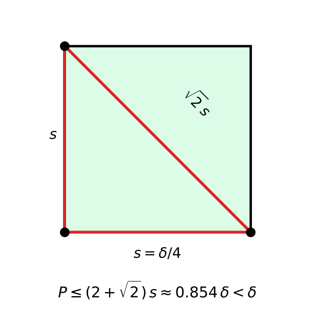
</p>

**Theorem.** The `δ × δ/2` box contains at most `8 × 2 = 16` points.

*Proof.* Assign every point to the square of its own half. By Lemma 2 each of the 8 squares receives at most 2 points, so the total is at most 16. ∎

<p align="center">
  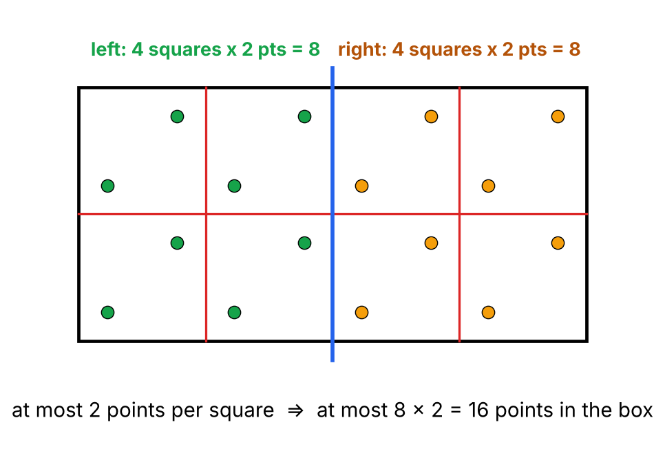
</p>

### Conclusion of the proof

Let `p_i` be the first vertex (in y-order) of a triangle with perimeter smaller than `δ`. By Lemma 1 and Step 3, the other two vertices lie in the box that starts at `p_i`. That box holds at most 16 points including `p_i`, so the other two vertices are among the **next 15 points** in the strip.

So for every point it is enough to check all pairs among the next 15 strip points, which is `O(1)` work per point. This is exactly why the implementation uses

```java
int limit = 15;
```

## Complexity

- Sorting by `x` and by `y` is done once: `O(n log n)`.
- Splitting `Y` into `Y_L` and `Y_R`, and building the strip, are linear scans: `O(n)`.
- The merge scan checks a constant number of triangles per point: `O(n)`.

This gives the recurrence

```text
T(n) = 2·T(n/2) + O(n)   ⟹   T(n) = O(n log n)
```

The solution passes the automatic submission check, including the performance tests on random and collinear inputs, well inside the 1 second limit.

## How to run

```bash
mvn -f problem2-triangle/pom.xml clean package
java -jar problem2-triangle/<your-jar-name>.jar < problem2-triangle/samples/<sample-input-file>
```

Run the unit tests with `mvn -f problem2-triangle/pom.xml test`.

Or type the input directly; remember to finish with `-1`:

```text
3
0 0
3 0
0 4
-1
```

Expected output:

```text
12.000
```

## Automated submission check

The repository has a GitHub Actions workflow (`.github/check.yml`, named **Check my submission**) that validates the packaged jar: file name, runnable main class, source files, and timed tests (sample, random and collinear inputs, 1 second limit per run).

To run it:

1. Open the **Actions** tab and choose **Check my submission**.
2. Click **Run workflow**, keep the branch on `main`.
3. In the `jar_path` field enter the path of the jar, for example `problem2-triangle/submissions/<student-id>.jar` (it can be left empty if `submissions/` holds exactly one jar).
4. Click **Run workflow** and open the finished run to read the check summary.

<p align="center">
  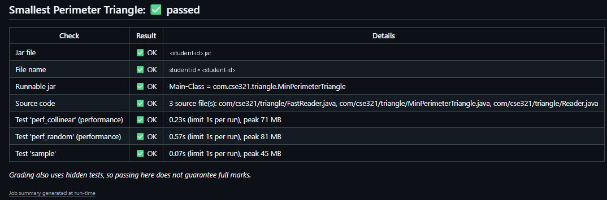
</p>

The check summary notes that grading also uses hidden tests, so passing it does not guarantee full marks.

---

## References

- GeeksforGeeks, *Fast I/O in Java in Competitive Programming* — <https://www.geeksforgeeks.org/dsa/fast-io-in-java-in-competitive-programming/>